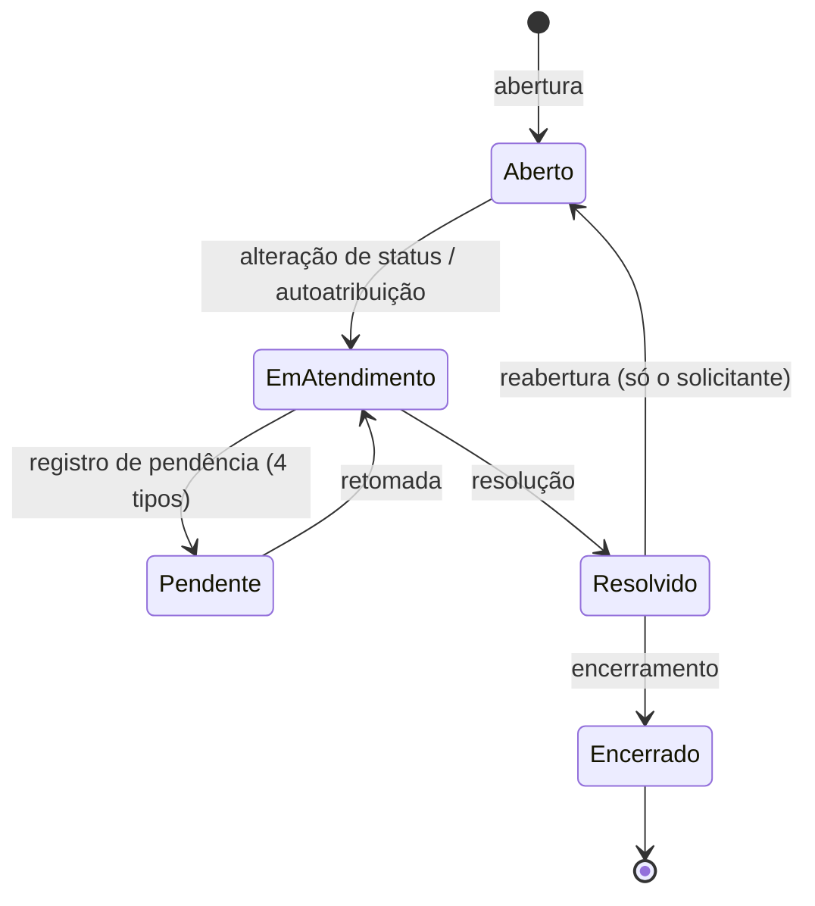

# Requisitos funcionais e regras de negócio

> Atualizado em 27/10/2026 (commit `bdb7667`). Convenção de confiança em [README.md](README.md).

Este capítulo descreve **o que o sistema faz**, como o código o implementa hoje. Não é o PRD: os identificadores de requisito (RF-xx, CHA-xx, RN-xx...) vêm dos comentários do código e só aparecem quando ajudam a localizar a regra. Não foram criados requisitos novos nem critérios de aceite. A ligação entre cada caso de uso da referência funcional e o código está em [casos-de-uso.md](casos-de-uso.md).

## 1. Atores

| Ator | Como o código o identifica |
|---|---|
| Visitante | Sem sessão; rotas com middleware `guest` (`routes/auth.php`). |
| Usuário autenticado | Sessão válida (`auth`); a autorização é por policy, não por nome de papel. |
| Solicitante | Papel `requester`, sem permissões no seeder. |
| Técnico, Gestor, Administrador | Papéis `technician`, `manager`, `admin`, com as permissões do seeder (ver [05-rotas-e-permissoes.md](05-rotas-e-permissoes.md)). |
| Equipe de atendimento | Ator abstrato do diagrama. No código não é um papel: a noção equivalente é a permissão `tickets.view_internal_notes` (divergência D6 em [casos-de-uso.md](casos-de-uso.md)). |
| Servidor de e-mail | Entrega o convite (`UserInvitation`) e a recuperação de senha. |
| Agendador | Executa `sla:record-breaches` a cada minuto, se alguém rodar `schedule:run`. |

## 2. Funcionalidades por módulo

| Módulo | Funcionalidade | Arquivos principais | Situação |
|---|---|---|---|
| Acesso | Cadastro público (sempre `requester`), login, recuperação de senha | `Auth/RegisteredUserController`, `AuthenticatedSessionController`, `PasswordResetLinkController`, `NewPasswordController` | Implementado |
| Acesso | Perfil: editar dados, trocar senha, excluir a própria conta | `ProfileController`, `Auth/PasswordController` | Implementado (exclusão: ver T3) |
| Chamados | Abrir, listar e filtrar, consultar detalhes, baixar anexo | `TicketController`, `OpenTicket`, `TicketListingQuery`, `TicketAttachmentController` | Implementado |
| Chamados | Comentar e anexar arquivos | `TicketCommentController`, `StoreTicketAttachments` | Implementado |
| Chamados | Reabrir chamado resolvido | `TicketReopeningController`, `ReopenTicket` | Implementado |
| Atendimento | Assumir, atribuir e reatribuir | `SelfAssignTicket`, `AssignTicket` | Implementado |
| Atendimento | Alterar status, registrar pendência, resolver, encerrar | `ChangeTicketStatus`, `RegisterTicketPending`, `ResolveTicket`, `CloseTicket` | Implementado |
| Atendimento | Nota interna; alterar prioridade, categoria e departamento | `TicketCommentController`, `UpdateTicketAttributes` | Implementado |
| Atendimento | Editar comentário | `EditTicketComment` | **Parcial:** Action e permissão `comments.edit_others` existem; não há rota nem tela |
| Gestão | Auditoria global e por chamado; painel de desempenho; exportação CSV | `AuditController`, `TicketAuditController`, `PerformanceReport`, `TicketCsvExport` | Implementado |
| Administração | Usuários (com convite), departamentos, categorias, papéis, matriz de permissões, catálogo, políticas de SLA | `UserController`, `DepartmentController`, `CategoryController`, `RoleController`, `RolePermissionController`, `PermissionController`, `SlaPolicyController` | Implementado |
| Sistema | Registro de violações de SLA | `RecordSlaBreaches`, `SlaClock::recordBreaches` | Implementado; depende de agendador externo |

## 3. Regras de negócio

Fontes principais: `app/Enums/TicketStatus.php`, `app/Actions/Tickets/*`, `app/Support/SlaClock.php`, `app/Models/Ticket.php`, `app/Policies/TicketPolicy.php`.

### 3.1 Ciclo de vida do chamado

Oito status (`TicketStatus`). As transições vêm de um único método, `TicketStatus::transitions()`, e cada uma aponta para o fluxo que a executa (`TicketTransitionFlow`). O que não está na tabela é recusado pelo backend.

"Pendente" resume quatro status: Aguardando solicitante, Pendente, Pendente Terceiros e Pendente Departamentos.

| De | Para | Fluxo | Permissão ou condição |
|---|---|---|---|
| Aberto | Em atendimento | Alteração de status (CHA-07) | `tickets.change_status` e **ter responsável**. Sem responsável, o caminho é atribuir ou autoatribuir. |
| Em atendimento | 4 tipos de pendência | Registro de pendência (CHA-08) | `tickets.change_status` e motivo obrigatório. |
| Em atendimento | Resolvido | Resolução (CHA-09) | `tickets.resolve` e resumo da solução. |
| Qualquer pendência | Em atendimento | Alteração de status | `tickets.change_status`. Encerra a pausa do SLA. |
| Resolvido | Aberto | Reabertura (CHA-10) | Ser o solicitante original, com justificativa. Não depende de permissão. |
| Resolvido | Encerrado | Encerramento (CHA-11) | `tickets.close`. |
| Encerrado | (nenhum) | — | Estado final. Não aceita comentário nem edição. |

**Campos da pendência** (`pendingFields()`):

| Tipo | Campos opcionais além do motivo |
|---|---|
| Aguardando solicitante, Pendente | previsão de retorno |
| Pendente Terceiros | fornecedor, protocolo, responsável, previsão de retorno |
| Pendente Departamentos | departamento relacionado (ativo), protocolo, responsável, previsão de retorno |

Campos de outro tipo são recusados (`prohibited`). A previsão de retorno é uma data (`Y-m-d`), sem horário, e não pode estar no passado.

### 3.2 Abertura (CHA-02, RF-05)

- O solicitante informa título, descrição, categoria (ativa) e anexos opcionais.
- O backend define número, solicitante, departamento (o do solicitante, que precisa estar ativo), status Aberto e **prioridade Média**. Qualquer `priority` enviada é ignorada.
- Identificador público `HD-` mais 8 caracteres de um alfabeto de 32 símbolos sem ambiguidade (sem O/0 e I/1), sorteados com `random_int` (`TicketNumberGenerator`). A unicidade vem do índice único de `tickets.ticket_number`; em colisão, `OpenTicket` tenta de novo até 5 vezes (`TicketNumberUnavailable` depois disso). A URL usa esse número, nunca o `id` (`Ticket::getRouteKeyName`).
- Repetição do mesmo envio (duplo clique, reenvio) é neutralizada por token UUID e `Cache::add`.
- Tudo ocorre em uma transação: política de SLA, chamado, evento `Created` e anexos. Se a transação falha, os arquivos já gravados são apagados.

### 3.3 Atribuição

| Operação | Quem | Regra |
|---|---|---|
| Atribuir (RF-08) | `tickets.assign` | Só para chamado **sem** responsável. |
| Reatribuir (RF-08) | `tickets.reassign` | Só com responsável. Permissão distinta. |
| Autoatribuir (RF-09) | Técnico elegível | Chamado Aberto e sem responsável. Muda responsável e status juntos (Em atendimento). |

"Elegível" (`User::eligibleAssignees`) é: usuário ativo cujo papel tem `tickets.self_assign`. O destino de uma atribuição precisa ser elegível. Se outra pessoa mudou o responsável enquanto o modal estava aberto, a Action lança `TicketAssignmentConflict`. Na autoatribuição, quem perde a disputa recebe uma mensagem neutra.

### 3.4 Comentários e notas internas (RF-11)

- Dois tipos: **público** e **interno** (`CommentVisibility`). Notas internas exigem `tickets.add_internal_note` e só são lidas por quem tem `tickets.view_internal_notes`. O filtro é aplicado na consulta (`TicketComment::scopeVisibleTo`).
- Chamado encerrado não recebe comentários.
- O primeiro comentário **público** de alguém da equipe (`tickets.view_internal_notes`) que **não** é o solicitante registra `first_response_at` e encerra o SLA de primeira resposta.
- Há histórico de versões, lido por `comments/{comment}/versions`, filtrado pela visibilidade que cada versão tinha.
- **A edição de comentário não está exposta**: a Action `EditTicketComment` e a permissão `comments.edit_others` existem, mas não há rota nem tela (RF-11 só parcialmente atendido).

### 3.5 SLA

**Políticas.** Uma política define, para uma prioridade, a meta de primeira resposta e a de resolução, em minutos corridos (sem horário comercial nem feriados), entre 1 e 525.600. **Só pode haver uma política ativa por prioridade**, garantido no banco por coluna virtual (`active_priority`) com índice único. Sem política ativa, o chamado nasce sem prazo ("Sem prazo definido").

**Cópia das metas.** Ao abrir (ou ao trocar a prioridade), o chamado copia a política e as metas (`sla_policy_id`, `sla_*_minutes`) e guarda os prazos (`first_response_due_at`, `resolution_due_at`). Editar uma política depois não altera chamados existentes.

**Relógio de resolução.** O prazo de resolução embute todas as pausas encerradas, e o tempo consumido é `meta − (prazo − instante do relógio)`.

| Evento | Efeito |
|---|---|
| Pendência registrada | Cria uma linha em `ticket_sla_pauses` e para o relógio no início da pausa. Antes disso, registra violações já vencidas. |
| Retomada | Fecha a pausa (grava fim e duração) e **estende** `resolution_due_at` pela duração. |
| Resolução | Grava `resolution_effective_seconds` (tempo consumido, sem pausas) e confere violação. |
| Reabertura | Estende o prazo pelo tempo que o chamado ficou Resolvido. O prazo de primeira resposta é mantido e o SLA não reinicia. |
| Encerramento | Sem efeito no SLA. |
| Troca de prioridade | Registra violações vencidas, busca a política da nova prioridade, recalcula o prazo de resolução descontando o tempo já consumido e só recalcula a primeira resposta se ela ainda não ocorreu. Grava o evento `SlaTargetsChanged`. Chamado resolvido ou encerrado não é recalculado. |

Um chamado só tem uma pausa aberta por vez, garantido por coluna gerada com índice único (`active_ticket_id`).

**Estados exibidos** (`SlaState`):

| Estado | Regra |
|---|---|
| Pausado | Status de pendência. |
| Sem prazo definido | Sem `resolution_due_at`. |
| Cumprido / Vencido | Chamado resolvido ou encerrado: resolvido até o prazo ou depois. |
| Vencido | Em curso e agora passou do prazo. |
| Em risco | Em curso, ainda no prazo e com **80% ou mais** da meta consumida (`SlaState::AT_RISK_PERCENT`). |
| No prazo | Demais casos em curso. |

O mesmo critério existe em PHP (`Ticket::slaState`) e em SQL (`scopeWhereSlaState`, para filtros), com ramo específico para SQLite e MariaDB (`atRiskSql`).

**Violações.** `SlaClock::recordBreaches` grava a **primeira** violação de cada indicador em `first_response_breached_at` e `resolution_breached_at` e cria um evento `SlaBreached` sem autor. Esses campos nunca são apagados, então um chamado pode estar "No prazo" agora (após uma troca de meta) e ainda ter violação histórica. O comando `sla:record-breaches` cobre os chamados em que ninguém agiu depois do prazo; ignora pausados, resolvidos e encerrados. Cada chamado é bloqueado com `lockForUpdate`, então rodar duas vezes não duplica registros.

### 3.6 Visibilidade (RF-07, RF-24)

`Ticket::scopeVisibleTo`:

- Com `tickets.view_all_departments`: vê todos.
- Sem ela: vê os que abriu, os que lhe foram atribuídos e, se tiver `tickets.self_assign`, os **Abertos e sem responsável**.

**Visão restrita** (`User::hasRestrictedTicketView`): quem não tem `tickets.view_internal_notes` (na prática, o Solicitante) não recebe prioridade, SLA nem solicitante nas telas, filtros, ordenações, exportação e dashboard (que redireciona para a listagem). O servidor recusa filtros proibidos com `prohibited` (`TicketIndexRequest`).

### 3.7 Anexos (RF-23)

- Em chamados e em mensagens. O anexo **herda a visibilidade da mensagem**; anexos da abertura são públicos.
- Limites padrão (`config/attachments.php`): 10 MB por arquivo, 5 por envio, 20 MB por envio, 20 arquivos e 100 MB por chamado.
- Tipos aceitos por extensão e **conferidos pelo conteúdo** (`finfo`): PDF, TXT, CSV, PNG, JPG/JPEG, WEBP, DOCX, XLSX. SVG, HTML, scripts e executáveis não entram.
- Verificações extras (`AttachmentInspector`): PDF sem JavaScript, ação automática ou arquivo embutido; DOCX e XLSX sem macros ou objetos incorporados; texto sem marcação nem bytes de controle; imagem legível.
- O arquivo é salvo com nome UUID em disco privado; o nome original só serve para exibição. O download é autorizado a cada requisição e responde 404 quando o usuário não pode ver o anexo.
- Não há exclusão de anexos nem varredura antivírus.

### 3.8 Exportação CSV (RF-21)

Mesmo escopo, filtros e ordenação da listagem, sobre todas as linhas visíveis. Separador `;`, UTF-8 com BOM, datas em UTC. Células que começam com `=`, `+`, `-`, `@`, tabulação ou retorno recebem apóstrofo (proteção contra injeção de fórmulas). A visão restrita exporta menos colunas. Sem resultados, responde 204. A autorização é **por papel** (`admin` ou `superadmin`), e não por permissão (ver [10-debitos-tecnicos.md](10-debitos-tecnicos.md), T2).

### 3.9 Indicadores

- **Dashboard** (`DashboardController`, RF-20): total e distribuição por status e prioridade, rankings por departamento e por técnico (8 itens, o resto agrupado), tempos médios de primeira resposta e de resolução efetiva, tudo sobre o escopo do usuário e um período.
- **Desempenho** (`PerformanceReport`, RF-25): por técnico, chamados atendidos (abertos no período e hoje atribuídos a ele), resolvidos (autor do último evento de resolução), cumprimento de SLA, tempos médios e evolução por período. Exige `reports.view_performance` e `tickets.view_all_departments`. O relatório carrega os chamados do período em memória.

### 3.10 Administração

- **Usuários:** inativar em vez de excluir; inativar revoga as sessões (driver `database`); edição concorrente detectada por `editVersion()`; o operador só concede papéis cujas permissões administrativas ele já possui; papel e situação da própria conta não são alteráveis; convite por e-mail só para usuário ativo.
- **Departamentos e categorias:** duas permissões independentes; inativação no lugar de exclusão.
- **Papéis e permissões:** ninguém retira `roles.manage` do próprio papel; o catálogo de permissões é somente leitura.
- **Políticas de SLA:** uma ativa por prioridade; histórico exige também `audit.view`.
- **Auditoria:** `audit_logs` e `ticket_histories` são somente-inserção.

## 4. Pontos ainda sem decisão

| Ponto | Situação |
|---|---|
| A exportação deveria ser uma permissão? | O PRD (RF-21) fala em "filtros e permissões"; o código usa o slug do papel (commit `c717ad5`). Pendente. |
| O Administrador conta como "equipe de atendimento"? | No código sim (tem `view_internal_notes`); no diagrama não (D6). Pendente. |
| A edição de comentário será entregue? | Pendente: implementar a rota ou retirar a permissão. |
| Verificação de e-mail obrigatória | O PRD diz "quando habilitada"; hoje não está. Pendente. |
