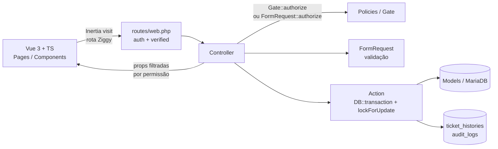
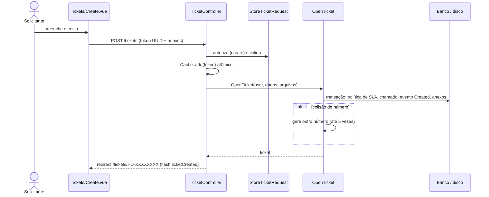
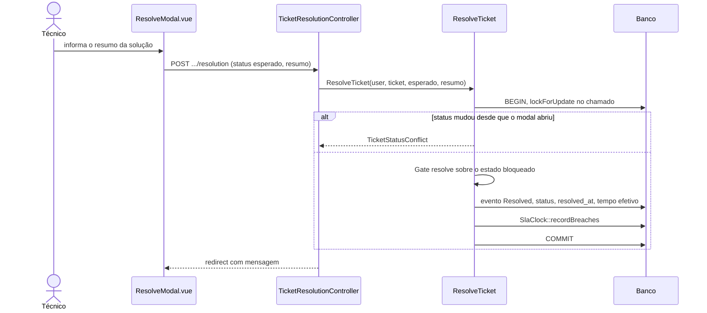
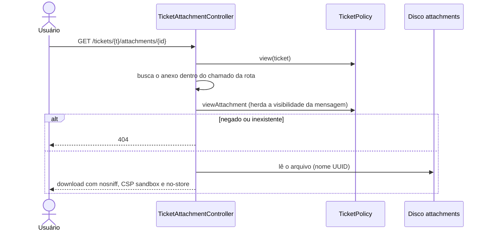
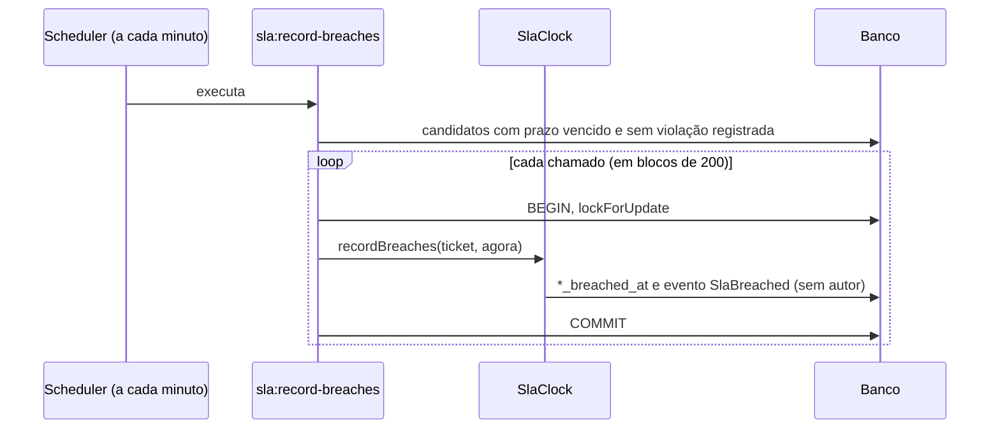

# Arquitetura

> Atualizado em 27/10/2026 (commit `bdb7667`). Convenção de confiança em [README.md](README.md).

## Visão em camadas

| Camada | Diretório | Responsabilidade |
|---|---|---|
| Rotas | `routes/web.php`, `auth.php`, `console.php` | Mapeamento HTTP. Os comentários citam o requisito (CHA-xx, ADM-xx, SLA-xx). O scheduler roda `sla:record-breaches` a cada minuto. |
| Controllers | `app/Http/Controllers` | Finos: autorizam, montam as props do Inertia e delegam a escrita a uma Action. Cada ação sobre o chamado tem controller próprio (`TicketStatusController`, `TicketResolutionController`...). |
| Form Requests | `app/Http/Requests/*` | Validação, mensagens em pt-BR e `authorize()`. Têm o trait `NormalizesListingFilters` e a classe auxiliar `Attachments`. |
| Actions | `app/Actions/*` | Regra de negócio transacional, agrupada por módulo, com exceções de conflito (`TicketStatusConflict`, `RoleEditConflict`...). |
| Policies | `app/Policies/*` | Autorização por permissão. `AppServiceProvider` define também o Gate `viewPerformance`. |
| Support | `app/Support/*` | Regras transversais: `SlaClock`, `TicketListingQuery`, `TicketCsvExport`, `AttachmentInspector`, `PerformanceReport`, `SingleSubmission`, `TicketNumberGenerator`. |
| Enums | `app/Enums/*` | `TicketStatus` (com as transições), `TicketPriority`, `SlaState`, `TicketEvent`, `AdminEvent`, `CommentVisibility`, `TicketTransitionFlow`. |
| Models | `app/Models/*` | Eloquent, escopos de visibilidade e históricos imutáveis. |
| Frontend | `resources/js` | Páginas Inertia, componentes, layouts, composables e `lib/*.ts` com tipos. |

## Padrões que se repetem

### 1. Action transacional com bloqueio e reautorização

Quase toda mutação de chamado segue a mesma sequência (ver `ResolveTicket`, `ChangeTicketStatus`, `CloseTicket`, `ReopenTicket`, `RegisterTicketPending`):

1. `DB::transaction`.
2. Relê o chamado com `lockForUpdate()`.
3. Compara com o estado que a tela mostrou ao usuário (`expected`); se mudou, lança uma exceção de conflito.
4. Confere se a transição é válida no estado atual.
5. **Reautoriza** com `Gate::forUser($editor)->authorize(...)` sobre o estado bloqueado.
6. Grava o chamado e um evento imutável em `ticket_histories`.

Exceção (**comprovado**): `UpdateTicketAttributes` não reautoriza dentro da transação; só o `UpdateTicketRequest` autoriza.

### 2. Concorrência otimista nos cadastros

Usuário, departamento, categoria, papel, política de SLA e a edição de atributos do chamado têm um método `editVersion()` (um `sha1` dos campos editáveis). O formulário envia a versão que carregou e a Action compara com a do banco sob `lockForUpdate`; se difere, a gravação é recusada com mensagem de conflito.

### 3. Históricos e auditoria somente-inserção

`ticket_histories`, `ticket_comment_versions` e `audit_logs` têm só `created_at` (`UPDATED_AT = null`) e `$guarded = ['*']`. Autor e instante vêm do backend, nunca do formulário. As chaves estrangeiras são `restrictOnDelete`.

### 4. Escopo de visibilidade antes de tudo

`Ticket::scopeVisibleTo($user)` é aplicado antes de filtro, ordenação, contagem e paginação, e reutilizado por listagem, detalhe, dashboard, desempenho e exportação. A policy `view` usa o mesmo escopo.

### 5. Props do Inertia já filtradas

O servidor decide o que enviar. Na visão restrita do solicitante, prioridade, SLA e solicitante nem chegam ao navegador (`TicketController::index/show`). A interface só reflete; o objeto `can` de cada página serve para exibir ou ocultar botões, e o backend revalida.

### 6. Anti-duplo-envio por token

Formulários de criação enviam um UUID gerado ao abrir a tela. `Cache::add` (atômico) garante que só o primeiro envio crie o registro. `SingleSubmission` implementa isso para categorias, departamentos e políticas de SLA; a abertura de chamado repete a mesma lógica em linha em `TicketController::store`.

### 7. Estado de SLA derivado, violação persistida

`Ticket::slaState()` compara os prazos gravados com o instante atual. A primeira violação de cada indicador é gravada em `*_breached_at` e nunca é apagada. `SlaClock` concentra o cálculo.

## Fluxos de dados

### Abertura de chamado

### Resolução (padrão das demais ações)

### Download de anexo

### Violação de SLA por comando agendado

## Frontend

Vue 3 (Composition API, `<script setup lang="ts">`) servido pelo Inertia, com Tailwind 3 e rotas nomeadas pelo Ziggy. Dados de componentes e composables em [04-estrutura-do-projeto.md](04-estrutura-do-projeto.md).

1. O controller envia props Inertia já filtradas por permissão (por exemplo, o objeto `can` da página de detalhes).
2. Ações do chamado são `POST/PUT` por modais; o servidor devolve redirecionamento com mensagens em `flash` (`success`, `info`, `warning`, `ticketCreated`), que o layout transforma em toasts.
3. Dados pesados vêm sob demanda: `assignableTechnicians` usa `Inertia::optional`, e histórico de SLA, auditoria e versões de comentário vêm de três endpoints JSON (todos com `Cache-Control: no-store, private`).
4. Formulários de criação enviam um `submission_token`; os de edição enviam a `version` carregada, para detecção de conflito.
5. `lib/navigation.ts` descreve o menu como dados: um item só aparece se a rota existe no Ziggy e o usuário tem as permissões listadas em `auth.permissions`. Isso só controla a exibição; o backend decide.

Acoplamento conhecido: o backend envia `status` e `priority` como **rótulos em português**, e `lib/ticket.ts` mapeia cor e regras por esses textos (ver T14 em [10-debitos-tecnicos.md](10-debitos-tecnicos.md)).

## Execução em segundo plano

- O único processo recorrente é `sla:record-breaches`, agendado a cada minuto com `withoutOverlapping(5)` (`routes/console.php`). Precisa de um agendador externo chamando `php artisan schedule:run`.
- Não existem jobs nem notificações em fila: `ShouldQueue` e `dispatch` não aparecem em `app/`. O serviço `queue` do Docker não tem trabalho a executar.

## Tratamento de erros

`bootstrap/app.php` converte 403 (e, fora de `local` e `testing`, 404, 500 e 503) em uma página Inertia neutra (`Pages/Error.vue`), sem detalhes internos. O middleware `HandleInertiaRequests` é anexado ao grupo `web`.

## Infraestrutura

- Sessão, cache e fila usam o banco (`SESSION_DRIVER=database`, `CACHE_STORE=database`, `QUEUE_CONNECTION=database`) nos exemplos de ambiente.
- Anexos ficam no disco privado `attachments` (`storage/app/private/attachments`), sem URL pública.
- Fuso horário da aplicação: UTC (`config/app.php`). A exportação CSV declara UTC nos cabeçalhos.
- Em Docker: `app` (Apache e PHP 8.3), `queue`, `scheduler` e `db` (MariaDB 11). Ver [09-instalacao-e-execucao.md](09-instalacao-e-execucao.md).
