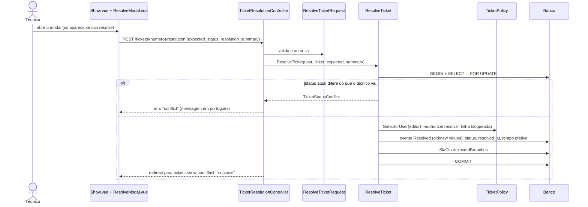

# Portfólio e entrevistas

> Atualizado em 27/10/2026 (commit `bdb7667` e alterações posteriores da documentação). Convenção de confiança em [README.md](README.md).

Este capítulo prepara uma apresentação técnica **honesta** do Help Desk Pro para portfólio e entrevistas de desenvolvimento Full Stack. Tudo o que está aqui vem do código, dos testes executados em 27/10/2026 ou de documentos do projeto. Não há métricas de desempenho, número de usuários, ganho de produtividade nem desafios inventados: o projeto não tem nenhum desses dados registrados.

## Como ler as marcas

| Marca | Significado |
|---|---|
| **[Código]** | Você consegue mostrar no repositório. É o que pode afirmar sem ressalva. |
| **[Documentado]** | Está em documento do projeto (`docs/pendencias.md`, `README.md`, PRD), não no código. Cite a fonte. |
| **[Confirmar]** | A justificativa ou o contexto só você sabe. Preencha ou não afirme. |

Os trechos entre `[colchetes]` são lacunas para você preencher. Não use o texto em entrevista antes de preenchê-los ou removê-los.

---

## 1. Apresentação curta

**Em 30 segundos.** O Help Desk Pro é um sistema web de gestão de chamados de suporte, feito em Laravel 12, Inertia 2 e Vue 3 com TypeScript. Cobre o ciclo completo do chamado (abertura, atribuição, pendências, resolução, reabertura e encerramento), com SLA, auditoria, anexos e acesso por papéis e permissões editáveis em tela. [Seu papel e o contexto do projeto.]

**Em 2 minutos.** Acrescente três pontos que o código sustenta: (1) cada mudança de estado é uma transação com bloqueio de linha, checagem do estado que o usuário viu e histórico imutável; (2) o servidor decide o que cada perfil enxerga, inclusive nos dados enviados ao navegador; (3) a suíte tem 1.486 testes que passaram em 27/10/2026, e eu conheço os limites dela (só SQLite, sem CI, sem testes de frontend). Termine dizendo o que ainda falta, por exemplo a edição de comentário e a verificação de e-mail, que estão documentadas como pendentes.

---

## 2. O problema que o sistema procura resolver

**Segundo o README e o PRD [Documentado]:** em operações de suporte, solicitações se dispersam, ficam sem responsável, sem histórico confiável e sem controle de prazos. O sistema responde com um fluxo único do chamado, prazos de SLA e rastreabilidade de cada evento.

**O que o código comprova [Código]:** existe um fluxo de oito status com transições controladas (`TicketStatus::transitions()`), atribuição com disputa tratada, SLA com pausas, auditoria somente-inserção e visibilidade por escopo.

**O que não está comprovado [Confirmar]:** se há ou houve uma operação real usando o sistema, quem seria o cliente e qual a escala. Nada no repositório registra isso. Apresente o projeto como uma implementação completa do domínio, **não** como um sistema em produção, a menos que você confirme.

---

## 3. Público-alvo e funcionalidades comprovadas

**Público-alvo.** Quatro perfis semeados: Solicitante, Técnico, Gestor e Administrador (padrão do seeder; os papéis são dados e podem ser editados). Detalhes em [05-rotas-e-permissoes.md](05-rotas-e-permissoes.md).

| Funcionalidade | Evidência no código | Evidência em teste |
|---|---|---|
| Abertura de chamado com anexos e identificador `HD-XXXXXXXX` | `OpenTicket`, `TicketNumberGenerator`, `StoreTicketRequest` | `TicketCreateTest`, `TicketAttachmentTest` |
| Atribuição, reatribuição e autoatribuição | `AssignTicket`, `SelfAssignTicket` | `TicketAssignmentTest`, `TicketSelfAssignmentTest` |
| Status, pendência (4 tipos), resolução, reabertura, encerramento | `ChangeTicketStatus`, `RegisterTicketPending`, `ResolveTicket`, `ReopenTicket`, `CloseTicket` | `TicketStatusChangeTest`, `TicketPendingTest`, `TicketResolutionTest`, `TicketReopeningTest`, `TicketClosingTest` |
| Comentários, notas internas e histórico de versões (leitura) | `TicketCommentController`, `TicketCommentVersionController` | `TicketCommentHistoryTest`, `TicketFirstResponseTest` |
| SLA: políticas, pausas, recálculo, violações | `SlaClock`, `RecordSlaBreaches`, `SlaPolicyController` | `TicketSlaPauseTest`, `TicketSlaPriorityChangeTest`, `TicketSlaResolutionTest`, `RecordSlaBreachesCommandTest`, `SlaClockTest` |
| Visão restrita do solicitante | `User::hasRestrictedTicketView`, `TicketIndexRequest` | `TicketRequesterViewTest` |
| Dashboard, desempenho, exportação CSV | `DashboardController`, `PerformanceReport`, `TicketCsvExport` | `DashboardTest`, `PerformanceTest`, `TicketExportTest` |
| Administração e matriz de permissões | `UserController`, `RoleController`, `RolePermissionController` | `tests/Feature/Admin/*` (14 arquivos) |
| Auditoria global e por chamado | `AuditController`, `TicketAuditController` | `TicketAuditTest`, `tests/Feature/Audit` |

**Não diga que existe:** notificações de chamado por e-mail, edição de comentário pela interface, exclusão de anexos, antivírus, verificação de e-mail obrigatória, API pública.

---

## 4. Stack e responsabilidade de cada tecnologia

| Tecnologia | Papel no projeto | Onde ver |
|---|---|---|
| **Laravel 12** (PHP 8.2+) | Rotas, validação (Form Requests), autorização (Policies e Gate), regras transacionais (Actions), Eloquent, scheduler, e-mails de senha e convite | `routes/`, `app/` |
| **Inertia 2** | Liga controllers a páginas Vue sem API separada: props, redirecionamentos com `flash`, recargas parciais | `HandleInertiaRequests`, `resources/js/app.ts` |
| **Vue 3 + TypeScript** | Interface em Composition API (`<script setup>`), componentes, composables, tipos por módulo | `resources/js` |
| **Ziggy** | Rotas nomeadas do Laravel disponíveis no JavaScript (`route('tickets.store')`) | `resources/views/app.blade.php` (`@routes`) |
| **Tailwind 3** | Estilo; sem biblioteca de componentes de terceiros | `resources/js/Components`, `tailwind.config.js` |
| **Vite 7** | Build e servidor de desenvolvimento; `vue-tsc` roda no build | `vite.config.js`, `package.json` |
| **MariaDB** | Banco alvo; colunas geradas e `lockForUpdate` dependem dele | `database/migrations` |
| **Pest / PHPUnit** | Testes de funcionalidade e unitários, em SQLite em memória | `tests/`, `phpunit.xml` |
| **Docker Compose** | `app` (Apache + PHP 8.3), `queue`, `scheduler`, `db` | `docker-compose.yml`, `Dockerfile` |
| **Axios** | Consultas JSON sob demanda (versões, SLA, auditoria), download do CSV e bootstrap | `resources/js/bootstrap.ts`, `Pages/Tickets/Index.vue`, `Pages/Tickets/Partials/AuditHistory.vue` |

Não há Pinia nem Vuex: o estado vem das props do Inertia, de `useForm` e de refs locais **[Código]**. `laravel/sanctum` e `@tailwindcss/vite` estão declarados e sem uso.

---

## 5. Arquitetura e fluxo de uma funcionalidade representativa

Escolha **"Resolver chamado"**: mostra, em um caminho curto, o Inertia, a validação, a autorização em camadas, a concorrência e o histórico.

**Roteiro para explicar em voz alta** (arquivos para abrir, nesta ordem):

1. `routes/web.php`: a rota `tickets.resolution.store`, dentro do grupo `auth` + `verified`.
2. `app/Http/Controllers/TicketResolutionController.php`: fino. Chama a Action e converte `TicketStatusConflict` em erro de validação.
3. `app/Http/Requests/Tickets/ResolveTicketRequest.php`: valida o resumo e o status esperado.
4. `app/Actions/Tickets/ResolveTicket.php`: transação, `lockForUpdate`, comparação com o status esperado, `Gate::forUser(...)->authorize('resolve', $current)`, recusa se houver pausa de SLA aberta, evento imutável com a resolução anterior preservada, tempo efetivo e violações.
5. `app/Policies/TicketPolicy.php` (`resolve`): `tickets.resolve`, status resolvível e acesso ao chamado.
6. `resources/js/Pages/Tickets/Show.vue` e `Partials/ResolveModal.vue`: os botões só aparecem conforme o objeto `can` que o servidor enviou.
7. `tests/Feature/Tickets/TicketResolutionTest.php`: 32 casos, incluindo conflito e reenvio.

**Camadas e padrões gerais:** [03-arquitetura.md](03-arquitetura.md).

---

## 6. Desafios técnicos identificados

Só entram desafios que o código ou os documentos do projeto registram. **Qual deles foi seu e o que você aprendeu é com você [Confirmar]**: escolha um, conte a sua parte (o que decidiu, o que errou, o que mediu) e não atribua a si o que fez a IA sem dizer.

| Desafio | Evidência | O que mostrar |
|---|---|---|
| **SLA correto com pausas, reabertura e troca de prioridade**, sem contar duas vezes o tempo parado nem perder o consumido | **[Código]** `SlaClock`, `ChangeTicketStatus`, `UpdateTicketAttributes`. **[Documentado]** `docs/pendencias.md`, decisões D3 (o tempo em "Resolvido" não conta; o prazo é estendido na reabertura), D2 (sem política ativa o chamado nasce sem prazo) e D6 (resolução menor que a primeira resposta é bloqueada) | `TicketSlaPriorityChangeTest`, `SlaClockTest` |
| **Quem conta como "equipe" na primeira resposta** | **[Documentado]** decisão D1: `view_internal_notes` e não ser o solicitante. **[Código]** `TicketCommentController` | `TicketFirstResponseTest` |
| **Detectar violações de SLA em chamados parados** | **[Documentado]** decisão D4: ações do chamado mais comando agendado. **[Código]** `RecordSlaBreaches`, `routes/console.php` | `RecordSlaBreachesCommandTest` |
| **Visão restrita do solicitante decidida no servidor**, com filtros e exportação coerentes | **[Documentado]** etapa V4 de `docs/pendencias.md`. **[Código]** `TicketIndexRequest` (`prohibited`), `TicketListingQuery` | `TicketRequesterViewTest` (13 casos) |
| **Anexos seguros**: conteúdo, visibilidade herdada da mensagem, download autorizado | **[Código]** `AttachmentInspector`, `TicketPolicy::viewAttachment`. **[Documentado]** a detecção de PDF perigoso é textual e não substitui antivírus | `TicketAttachmentTest` |
| **Concorrência**: dois técnicos assumindo o mesmo chamado | **[Código]** `SelfAssignTicket` com `lockForUpdate` e mensagem neutra para quem perde | `TicketSelfAssignmentTest` (a prova real do lock é em MariaDB, que não foi testada) |
| **Teste de exportação intermitente**, corrigido em 24/10/2026 | **[Documentado]** `docs/pendencias.md`: o filtro `title=a` sobre título aleatório da factory às vezes devolvia 204; o título foi fixado e o arquivo rodou 6 vezes verde | `TicketExportTest` |
| **Mudanças de regra durante o projeto** | **[Documentado]** `docs/pendencias.md`: a Visão geral foi retirada do solicitante e a matriz passou a permitir editar qualquer papel, por pedidos posteriores | `DashboardTest`, `RolePermissionMatrixTest` |

---

## 7. Decisões arquiteturais comprovadas e seus trade-offs

O quadro completo (16 decisões) está em [11-decisoes-arquiteturais.md](11-decisoes-arquiteturais.md). Aqui, as que mais rendem em entrevista.

| Decisão | Comprovada em | Trade-off | Justificativa |
|---|---|---|---|
| Monólito com Inertia, sem API separada | **[Código]** não há rotas de API; `routes/web.php` | Um só lugar para regras e rotas; sem consumidores externos | **[Documentado]** PRD 3.2. A motivação pessoal é **[Confirmar]** |
| Actions transacionais para mudanças de estado | **[Código]** `app/Actions/Tickets/*` | Consistência e testabilidade; repetição de estrutura entre as classes | Inferida do código. **[Confirmar]** |
| Permissões em tabelas, não no código | **[Código]** `RolesAndPermissionsSeeder`, `User::hasPermission` | A administração muda o acesso sem deploy; o que vale numa instalação depende do banco | **[Documentado]** PRD 7 |
| Exportação CSV por papel (exceção) | **[Código]** `TicketExportController::ALLOWED_ROLES` | Foge do RBAC; Gestor e papéis personalizados não exportam | **[Documentado]** commit `c717ad5`. Motivo **[Confirmar]** |
| Metas de SLA copiadas para o chamado | **[Código]** colunas `sla_*` em `tickets` | Editar a política não reescreve o passado; mais colunas | **[Documentado]** migration `add_sla_columns` |
| Prazo de resolução embute as pausas | **[Código]** `SlaClock` | Sem dupla contagem; o prazo exibido muda a cada pausa | **[Documentado]** RNF-10 |
| Violação persistida, estado derivado | **[Código]** `*_breached_at`, `Ticket::slaState` | Auditoria histórica; um chamado pode estar "No prazo" e ter violação | **[Documentado]** RN-15 |
| Concorrência otimista por `editVersion` | **[Código]** `editVersion()` em 6 models | Detecta edição concorrente sem bloquear; exige devolver a versão no formulário | **[Código]** (comentário sobre `updated_at`) |
| Colunas geradas para unicidade | **[Código]** `active_priority`, `active_ticket_id` | Garantia no banco; só exercitadas em SQLite | Inferida. **[Confirmar]** |
| Testes em SQLite em memória | **[Código]** `phpunit.xml` | Suíte rápida (cerca de 2 min); sem prova de locks e SQL de MariaDB | Inferida. **[Confirmar]** |
| Minutos corridos no SLA | **[Código]** `SlaPolicy` | Simples; sem calendário comercial | **[Documentado]** README |

---

## 8. Segurança: o que existe e o que falta

**Existe [Código]** (detalhes e evidências em [07-seguranca.md](07-seguranca.md)):

- Autorização em camadas: Policy no controller e no Form Request, reautorização na Action sobre a linha bloqueada, escopo no SQL e props filtradas.
- Identificador público aleatório e escopo de visibilidade contra enumeração (IDOR).
- Anexos validados por conteúdo, disco privado, nome UUID, download com `nosniff` e CSP `sandbox`, 404 quando negado.
- CSV com neutralização de fórmulas; busca com escape de `%` e `_`.
- Limitador de 5 tentativas de login; recuperação de senha com resposta uniforme; cadastro público força o papel `requester`.
- Prevenção de elevação de privilégio em `Role::isGrantableBy`; ninguém retira `roles.manage` do próprio papel.
- Nenhum `v-html` no frontend; histórico e auditoria somente-inserção.

**Limitações conhecidas [Código], para assumir antes que perguntem:**

1. O login não barra usuário inativo e não há teste (T4).
2. `DatabaseSeeder` cria `test@example.com` com senha conhecida (T6).
3. `ProfileController::destroy` apaga o usuário de verdade, em conflito com as chaves `restrictOnDelete` (T3).
4. Cadastro público sem limitador próprio; `verified` não bloqueia (T5).
5. `UpdateTicketAttributes` não reautoriza sob lock (T8).
6. Sem antivírus; sem exclusão de anexos.
7. O Inertia compartilha o objeto do usuário inteiro (campos ocultos não saem).
8. `docker compose up` sobe em modo desenvolvimento (`APP_DEBUG=true`) por causa do override.
9. Não foram feitos teste de intrusão, `composer audit` nem `npm audit`.

**Não afirme** que o sistema é seguro ou pronto para produção.

---

## 9. Testes e evidências de qualidade

| Evidência | Fato | Origem |
|---|---|---|
| Suíte | **1.486 testes aprovados, 0 falhas, 9.596 asserções, 122,78 s** | Execução de `php artisan test --compact` em 27/10/2026 |
| Build | `npm run build` (`vue-tsc` + Vite) sem erros, 11,52 s | Execução em 27/10/2026 |
| Tamanho | 1.039 chamadas `test()`/`it()` em 59 arquivos; datasets expandem para 1.486 casos | Contagem estática |
| Estilo | Pest com `RefreshDatabase`, seeder real e usuários por papel; Actions montam o cenário e a rota HTTP é exercitada; contratos do Inertia por `assertInertia` | `tests/Pest.php`, `tests/Feature/*` |
| Tipos | TypeScript `strict`; um único `any` no frontend | `tsconfig.json`, varredura |

**Limites que você deve dizer:** só SQLite (locks e SQL de MariaDB sem prova); conflitos simulados com versão desatualizada, não com requisições paralelas; sem testes de frontend; sem CI; sem teste de login de inativo; a edição de comentário só é testada na Action. Esses números valem para aquela execução; não são cobertura de código (não há relatório de cobertura).

---

## 10. Débitos técnicos e próximos passos realistas

Lista completa em [10-debitos-tecnicos.md](10-debitos-tecnicos.md) (T1 a T30). Os que um avaliador mais provavelmente notaria:

| Débito | Próximo passo realista |
|---|---|
| T4 login de inativo | Checar `is_active` na autenticação e testar |
| T6 seeder não idempotente e usuário de teste | Condicionar ao ambiente `local` e usar `firstOrCreate` |
| T3 exclusão de conta | Inativar em vez de excluir, ou bloquear com vínculos |
| T1 edição de comentário | Implementar a rota e a tela, ou remover a permissão `comments.edit_others` |
| T2 exportação por papel | Criar a permissão `tickets.export` e migrar |
| T16 arquivo `lsp-*.php` no Git | Remover e ignorar |
| T20 e T22 sem CI e testes só em SQLite | Pipeline com testes e `npm run build`, e parte da suíte em MariaDB |
| T27 e T28 README desatualizado | Corrigir permissões do Administrador e a menção a seeders idempotentes |

---

## 11. Melhorias que elevariam o nível profissional

Sugestões desta análise; nenhuma está implementada nem estimada pelo autor.

| Melhoria | Por que ajuda numa avaliação |
|---|---|
| Pipeline de CI (testes, `npm run build`, Pint) com selo no README | Mostra que a qualidade é verificável a cada commit |
| Rodar a suíte também em MariaDB (serviço no CI) | Fecha a maior lacuna declarada: locks e colunas geradas |
| Testes de concorrência reais para a autoatribuição | Prova o que hoje é só inspeção de código |
| Larastan (PHPStan) e ESLint com Prettier | Qualidade estática que hoje não existe |
| Testes de componentes (Vitest) para `useListing`, `useLeaveGuard` e formulários críticos | Cobre o frontend, hoje só verificado por tipos |
| Substituir os rótulos em português por valores de enum no frontend (T14) | Remove um acoplamento frágil |
| Reaproveitar `useListing` em `Tickets/Index.vue` (hoje tem lógica própria) | Reduz duplicação na tela principal |
| README com capturas de tela, GIF do fluxo e a seção "Limitações" atualizada | É o que o recrutador vê primeiro |
| Demo hospedada com dados fictícios e contas por papel (sem `test@example.com`) | Permite avaliar sem instalar |
| ADRs curtos para as 5 decisões principais, com a sua justificativa | Transforma "inferido" em "registrado" |
| Notificações de chamado por e-mail via fila | Usa de fato o serviço `queue` do Docker |
| Licença e remoção de resíduos do esqueleto (T17) | Higiene de repositório público |

---

## 12. Perguntas técnicas e respostas-modelo

Para cada pergunta: a **resposta-modelo** (baseada no que o código faz), os **arquivos para estudar** e, quando houver, o que **só você pode confirmar**. Responda com as suas palavras; não decore.

### 12.1 Laravel: controllers, models, validação e autorização

**P1. Por que os controllers são tão finos? O que é uma Action aqui?**
*Resposta-modelo.* O controller autoriza, valida pelo Form Request e delega. A regra de negócio fica numa classe invocável por caso de uso, a Action, que abre a transação, relê o chamado com `lockForUpdate`, compara com o estado que a tela mostrou, confere a transição, reautoriza sobre a linha bloqueada e grava o chamado e o evento juntos. Assim a regra não se espalha e há um ponto único para testar. O custo é a repetição de estrutura entre as Actions.
*Estudar:* `TicketResolutionController`, `ResolveTicket`, `ChangeTicketStatus`, `CloseTicket`.
*Confirmar:* por que escolheu Actions em vez de Services ou Jobs.

**P2. Como funciona a validação? Onde ela acontece?**
*Resposta-modelo.* Em Form Requests, um por ação. `StoreTicketRequest` valida título, descrição, categoria (`Rule::exists(...)->where('is_active', true)`), token de envio UUID e anexos (`Attachments::rules()` e a regra `ValidAttachment`). O método `after()` recusa a abertura se o solicitante não tem departamento ativo. Só os campos permitidos (`FIELDS`) são usados: autor, departamento, status, prioridade e identificador vêm do backend, então qualquer valor enviado a mais é ignorado. As mensagens estão em português. O formulário Vue repete as regras para dar retorno imediato, mas o servidor valida tudo de novo.
*Estudar:* `app/Http/Requests/Tickets/StoreTicketRequest.php`, `app/Http/Requests/Concerns/Attachments.php`, `app/Rules/ValidAttachment.php`, `OpenTicket`.

**P3. Como a autorização é feita? Por que em tantas camadas?**
*Resposta-modelo.* Cada camada protege um risco diferente. A Policy (`TicketPolicy`) decide pela permissão do papel, não pelo nome dele. O Form Request autoriza antes de validar. A Action **reautoriza** com `Gate::forUser($editor)->authorize(...)` sobre a linha bloqueada, porque o estado pode ter mudado entre a tela e a gravação. O escopo `Ticket::scopeVisibleTo` filtra no SQL, e as props enviadas ao Vue já vêm filtradas. A interface só esconde botões; o backend sempre revalida. Uma exceção que eu assumo: a exportação CSV usa o slug do papel.
*Estudar:* `TicketPolicy`, `Ticket::scopeVisibleTo`, `ResolveTicket`, `TicketExportController`, [05-rotas-e-permissoes.md](05-rotas-e-permissoes.md).
*Ressalva:* `UpdateTicketAttributes` não reautoriza sob lock (T8).

**P4. O que há de especial nos models?**
*Resposta-modelo.* `Ticket` concentra o escopo de visibilidade, o estado de SLA derivado (`slaState`, com a versão em SQL em `scopeWhereSlaState`) e usa o `ticket_number` como chave de rota. Os modelos de histórico, auditoria, anexo e pausa usam `$guarded = ['*']` e `forceCreate`, com campos definidos pelo backend, e os de histórico não têm `updated_at`. `User` tem `hasPermission`, `effectivePermissions` e `hasRestrictedTicketView`. Enums (`TicketStatus`, `TicketPriority`, `SlaState`) guardam as regras de transição e os rótulos.
*Estudar:* `app/Models/Ticket.php`, `TicketHistory.php`, `User.php`, `app/Enums/TicketStatus.php`.

**P5. Por que um identificador público aleatório em vez do `id`?**
*Resposta-modelo.* Para não expor sequência nem permitir enumerar chamados. `TicketNumberGenerator` monta `HD-` mais 8 caracteres de um alfabeto de 32 símbolos sem ambiguidade (sem O/0 e I/1), com `random_int`. A unicidade final é do índice único; em colisão, `OpenTicket` tenta de novo até 5 vezes. Mesmo assim, conhecer o identificador não basta: `TicketPolicy::view` aplica o escopo.
*Estudar:* `TicketNumberGenerator`, `OpenTicket`, `Ticket::getRouteKeyName`.

**P6. Como você evita mass assignment?**
*Resposta-modelo.* `User` só aceita `name`, `email` e `password` em massa; `role_id` e `department_id` são atribuídos explicitamente (o cadastro público força `requester`). Os modelos de histórico e auditoria bloqueiam tudo e usam `forceCreate` com campos montados no backend.
*Estudar:* `User::$fillable`, `RegisteredUserController`, `TicketHistory`.

**P7. Como o sistema se comporta com muitos dados?**
*Resposta-modelo.* **Não medi.** Sei de pontos que cresceriam mal: `TicketPolicy::view` consulta o banco a cada chamada (T12), `PerformanceReport` carrega os chamados do período em memória (T13), e sessão, cache e fila usam o banco nos exemplos de ambiente. A exportação lê em blocos, e o comando de SLA processa em blocos de 200. Eu mediria antes de otimizar.
*Estudar:* `TicketPolicy::view`, `PerformanceReport`, `TicketCsvExport`, `RecordSlaBreaches`.

### 12.2 Vue.js: componentes, estado e formulários

**P8. Como o estado é gerenciado? Por que sem Pinia?**
*Resposta-modelo.* O estado de servidor vem das props do Inertia e é recarregado a cada navegação ou ação; o estado de tela fica em `ref`, `computed` e `useForm`. O que se repete virou composable: `useListing` (pesquisa, filtros, ordenação e paginação no servidor, sincronizados com a URL), `useLeaveGuard` e `useToast`. Como o servidor é a fonte da verdade, não senti necessidade de um store global.
*Estudar:* `resources/js/composables/*.ts`, `Pages/Admin/Users/Index.vue`.
*Confirmar:* se avaliou Pinia e por que descartou.

**P9. Como o formulário de abertura funciona?**
*Resposta-modelo.* `Tickets/Create.vue` usa `useForm` com título, descrição, categoria, anexos e o `submission_token` recebido do servidor. Valida no cliente com as mesmas regras do `StoreTicketRequest` e envia com `form.post`; os erros do servidor aparecem por campo (inclusive `attachments.0`) e o foco vai ao primeiro erro. `useLeaveGuard` pede confirmação ao sair com alterações e é desligado durante o envio (`setSubmitting`).
*Estudar:* `Pages/Tickets/Create.vue`, `composables/useLeaveGuard.ts`, `Components/AttachmentPicker.vue`.

**P10. Como a interface sabe o que mostrar a cada perfil?**
*Resposta-modelo.* De duas fontes, ambas só de exibição. O objeto `can` de cada página (por exemplo, `can.resolve` em `Show.vue`) vem da Policy. O menu vem de `lib/navigation.ts`, que descreve cada item com rota e permissões e consulta `auth.permissions`. Se alguém forçar a URL, o backend nega.
*Estudar:* `Pages/Tickets/Show.vue`, `lib/navigation.ts`, `Components/Sidebar.vue`, `HandleInertiaRequests`.

**P11. Como você usa TypeScript?**
*Resposta-modelo.* Modo `strict`, com `vue-tsc` dentro de `npm run build`. Os tipos de cada módulo ficam em `lib/*.ts`, e os campos que somem na visão restrita são opcionais. Há um único `any`. A fraqueza que conheço: `status` e `priority` chegam como rótulos em português e `lib/ticket.ts` mapeia por esses textos, então renomear um rótulo no PHP não gera erro de compilação (T14).
*Estudar:* `lib/ticket.ts`, `tsconfig.json`, `app/Enums/TicketStatus.php`.

**P12. E os testes de frontend?**
*Resposta-modelo.* Não existem. A cobertura é de tipos (`vue-tsc`) mais testes de backend que verificam as props do Inertia. É uma lacuna declarada; começaria por `useListing` e `useLeaveGuard` com Vitest.
*Estudar:* `tests/Feature/Tickets/TicketIndexTest.php` (uso de `assertInertia`).

### 12.3 Inertia.js: comunicação entre frontend e backend

**P13. Como o frontend conversa com o backend sem uma API?**
*Resposta-modelo.* Cada página é um componente Vue que o controller devolve com `Inertia::render` e props. Ações são requisições do Inertia (`form.post`, `router.put`) que o servidor responde com redirecionamento e mensagens em `flash` (`success`, `info`, `warning`, `ticketCreated`), que o layout transforma em toasts. As rotas são nomeadas no Laravel e usadas no Vue pelo Ziggy.
*Estudar:* `TicketController::show`, `resources/js/app.ts`, `HandleInertiaRequests`.

**P14. O que são recargas parciais e consultas JSON no projeto?**
*Resposta-modelo.* Dados pesados não vão na primeira carga. `assignableTechnicians` usa `Inertia::optional` e é pedido por `router.reload({ only: [...] })` quando o modal abre. O histórico de SLA, a auditoria e as versões de comentário vêm de três endpoints JSON lidos por Axios, todos com `Cache-Control: no-store, private`.
*Estudar:* `TicketController` (`assignableTechnicians`), `Partials/AssignTechnicianModal.vue`, `TicketSlaHistoryController`, `TicketAuditController`.
*Confirmar:* por que esses três ficaram como JSON e não como props.

**P15. Que dados compartilhados todas as páginas recebem? Há risco?**
*Resposta-modelo.* `auth.user`, `auth.permissions` (calculado sob demanda) e `flash`. O risco que identifiquei: o objeto do usuário inteiro é compartilhado; campos ocultos como `password` não saem, mas e-mail, papel e situação sim. Um DTO com só o necessário seria mais seguro.
*Estudar:* `app/Http/Middleware/HandleInertiaRequests.php`.

**P16. Como um conflito de edição chega ao usuário?**
*Resposta-modelo.* O modal envia o status que o técnico viu (`expected_status`). Se mudou, a Action lança `TicketStatusConflict` e o controller a converte em erro de validação com a chave `conflict` e uma mensagem pedindo para conferir os dados. Nos cadastros, o mesmo papel é feito pelo `editVersion()`.
*Estudar:* `TicketResolutionController`, `TicketStatusConflict`, `UserController::update`, `UpdateUser`.

### 12.4 Modelagem de dados e integridade

**P17. Como o banco garante a integridade?**
*Resposta-modelo.* Chaves estrangeiras `restrictOnDelete` em todo o domínio (só `role_permissions` usa `cascadeOnDelete`), inativação no lugar de exclusão, unicidades no banco e históricos somente-inserção. Duas regras de negócio viraram índice: uma política de SLA ativa por prioridade (`active_priority`, coluna virtual) e uma pausa aberta por chamado (`active_ticket_id`, coluna gerada).
*Estudar:* migrations `create_ticket_sla_pauses_table` e `add_active_priority_unique_to_sla_policies_table`, [06-banco-de-dados.md](06-banco-de-dados.md).
*Ressalva:* as colunas geradas só foram exercitadas em SQLite.

**P18. Por que guardar `old_values` e `new_values` em JSON?**
*Resposta-modelo.* O histórico precisa refletir o que valia no momento do evento, inclusive rótulos como o nome do status, sem depender do cadastro atual, e cada tipo de evento tem campos diferentes. O trade-off é perder consultas por coluna: para relatórios eu usaria os campos do próprio chamado. A justificativa é inferida do código.
*Estudar:* `TicketHistory`, `ResolveTicket` (corpo do evento), `TicketAuditController`.
*Confirmar:* se a escolha foi consciente.

**P19. Por que copiar as metas de SLA para o chamado?**
*Resposta-modelo.* Para que editar uma política não reescreva o passado: o chamado guarda `sla_policy_id`, as metas e os prazos. O custo são mais colunas e o recálculo explícito na troca de prioridade.
*Estudar:* migration `add_sla_columns_to_tickets_table`, `SlaClock`, `UpdateTicketAttributes`.

**P20. O que acontece se alguém tenta excluir um usuário com chamados?**
*Resposta-modelo.* Deveria falhar por integridade, mas o fluxo de exclusão da própria conta usa `delete` real e eu não o executei com atividade, então é uma inferência do esquema. É o débito T3; a correção é inativar em vez de excluir.
*Estudar:* `ProfileController::destroy`, `tests/Feature/ProfileTest.php`.

### 12.5 Segurança

**P21. Como evita que um usuário veja ou baixe o que não deve?**
*Resposta-modelo.* Em três pontos. O identificador público é aleatório e `view` aplica o escopo. O anexo é buscado dentro do chamado da rota e `viewAttachment` herda a visibilidade da mensagem (nota interna exige `view_internal_notes`; negado vira 404). O download é autorizado a cada requisição e entregue com `nosniff` e CSP `sandbox`.
*Estudar:* `TicketAttachmentController`, `TicketPolicy::viewAttachment`, `TicketAttachmentTest`.

**P22. Como trata arquivos enviados?**
*Resposta-modelo.* Lista de extensões, tipo detectado pelo conteúdo (`finfo`), verificações por tipo (PDF sem JavaScript ou ação automática; Office sem macros ou objetos incorporados; texto sem marcação), nome UUID e disco privado, com cotas. A detecção de PDF é textual e não substitui antivírus; também não há exclusão de anexos.
*Estudar:* `AttachmentInspector`, `ValidAttachment`, `config/attachments.php`, `StoreTicketAttachments`.

**P23. E CSRF, XSS e SQL injection?**
*Resposta-modelo.* CSRF e sessão são os do Laravel, no grupo `web`; **não auditei** o token de forma específica além disso. XSS: o frontend não usa `v-html` nem `innerHTML`, e o Vue escapa o conteúdo. SQL: Eloquent com bindings; na busca, `%` e `_` são escapados; os trechos SQL manuais (`atRiskSql`) usam bindings.
*Estudar:* `TicketListingQuery`, `Ticket::atRiskSql`, varredura em `resources/js`.

**P24. Quais são os pontos fracos de segurança?**
*Resposta-modelo.* Os da seção 8: login de inativo não barrado, usuário de teste com senha conhecida no seed, exclusão de conta própria, cadastro sem limitador, `UpdateTicketAttributes` sem reautorização, ausência de antivírus e de auditoria de dependências. Eu os registrei e sei a correção de cada um; não afirmo que o sistema esteja pronto para produção.
*Estudar:* [07-seguranca.md](07-seguranca.md), `AuthenticatedSessionController`, `LoginRequest`.

### 12.6 Testes e manutenção

**P25. Como você testa? Mostre um exemplo.**
*Resposta-modelo.* Pest com o seeder real e um usuário por papel. O teste monta o estado com as próprias Actions e depois exercita a rota HTTP, verificando resposta, banco e props do Inertia. `TicketResolutionTest` tem casos de papéis sem permissão, status errado, conflito e reenvio.
*Estudar:* `tests/Feature/Tickets/TicketResolutionTest.php`, `tests/Pest.php`, `phpunit.xml`.

**P26. Os testes provam a concorrência?**
*Resposta-modelo.* Não por completo. O conflito é simulado com um status esperado desatualizado, e o teste de reenvio verifica que o chamado só é resolvido uma vez, mas não há requisições paralelas reais, e a suíte roda em SQLite, onde `lockForUpdate` não tem efeito. A prova real exigiria MariaDB.
*Estudar:* `TicketResolutionTest` (caso "a repeated or concurrent submission..."), `TicketSelfAssignmentTest`.

**P27. Já teve um teste instável? O que fez?**
*Resposta-modelo.* **[Documentado]** Em 24/10/2026, `TicketExportTest` falhou de forma intermitente: o filtro `title=a` usava um título aleatório da factory que às vezes não tinha "a" e devolvia 204. Era instabilidade antiga do teste, não regressão; o título foi fixado e o arquivo rodou 6 vezes verde.
*Estudar:* `docs/pendencias.md` (resultado de 24/10/2026), `tests/Feature/Tickets/TicketExportTest.php`.

**P28. Como acrescentaria um novo status ou uma nova permissão?**
*Resposta-modelo.* Status: incluir o caso em `TicketStatus`, declarar as transições em `transitions()` (a fonte única) e o fluxo em `TicketTransitionFlow`; depois ajustar `lib/ticket.ts`, que ainda mapeia por rótulo (T14). Permissão: incluir em `RolesAndPermissionsSeeder::PERMISSIONS`; como o seeder só associa a papéis recém-criados, bancos existentes precisam de uma migration de dados com `insertOrIgnore`, como `add_performance_report_permission`; depois a Policy e, se for menu, `lib/navigation.ts`.
*Estudar:* `TicketStatus`, `RolesAndPermissionsSeeder`, `database/migrations/2026_10_24_000003_add_performance_report_permission.php`.

**P29. Há código morto ou incompleto?**
*Resposta-modelo.* Sim, e está registrado: `EditTicketComment` e a permissão `comments.edit_others` existem sem rota nem tela (T1); `laravel/sanctum` e `@tailwindcss/vite` estão declarados sem uso; há componentes herdados do esqueleto (`NavLink`, `ResponsiveNavLink`) e `ExampleTest`.
*Estudar:* `app/Actions/Tickets/EditTicketComment.php`, [10-debitos-tecnicos.md](10-debitos-tecnicos.md).

**P30. Como alguém novo sobe o projeto?**
*Resposta-modelo.* XAMPP: `composer install`, `npm install`, `.env`, `key:generate`, `migrate --seed` e `npm run dev`; ou Docker Compose. O SLA precisa de `schedule:run` a cada minuto (no Docker, o serviço `scheduler`). Atenção ao `docker-compose.override.yml`, que é carregado automaticamente e liga o modo desenvolvimento.
*Estudar:* [09-instalacao-e-execucao.md](09-instalacao-e-execucao.md), `docker-compose.yml`, `docker/entrypoint.sh`.

### 12.7 Trade-offs e decisões

**P31. Por que Inertia e não uma API com SPA?**
*Resposta-modelo.* Evita duplicar autorização e contratos entre duas aplicações, mantém roteamento e validação no Laravel e entrega a experiência de SPA. O custo: não há API para terceiros, e por isso o `laravel/sanctum` ficou sem uso.
*Estudar:* `routes/web.php`, `HandleInertiaRequests`, `composer.json`.
*Confirmar:* sua razão real; o PRD cita monólito, não o motivo.

**P32. Permissões no banco ou no código? O que se perde?**
*Resposta-modelo.* No banco, para a administração ajustar o acesso sem deploy. Perde-se a garantia de que a matriz seja a do repositório: o que vale numa instalação é o conteúdo de `role_permissions`. Por isso o catálogo documenta a matriz padrão do seeder e os testes cobrem papéis alterados.
*Estudar:* `RolesAndPermissionsSeeder`, `UpdateRolePermissions`, `RolePermissionMatrixTest`, [casos-de-uso.md](casos-de-uso.md) (seção 7).

**P33. Por que a exportação CSV é uma exceção ao modelo de permissões?**
*Resposta-modelo.* No commit `c717ad5` a exportação passou a depender do papel (`admin` ou `superadmin`). O PRD fala em "filtros e permissões", então é uma divergência que eu reconheço. A correção é uma permissão própria.
*Estudar:* `TicketExportController`, `TicketExportTest`, `git show c717ad5`.
*Confirmar:* o motivo da restrição; só você sabe.

**P34. Se começasse de novo, o que faria diferente?**
*Resposta-modelo.* Com base no que está documentado: CI desde o primeiro commit, testes em MariaDB para o que depende de lock, valores de enum no frontend em vez de rótulos, uma permissão para exportação e a edição de comentário resolvida ou removida. [O que você mudaria, com as suas palavras.]

**P35. Sobre o uso de IA no desenvolvimento.**
*Resposta-modelo.* O histórico mostra o uso: 32 dos 34 commits até `bdb7667` terminam com `Co-Authored-By: Claude`, e há documentos de fluxo guiado por prompts (`docs/prompt-qa-cowork.md`, `docs/pendencias.md`). Diga o que **você** definiu, revisou e validou, e onde a IA ajudou: [as suas palavras]. A postura mais defensável é mostrar que entende o código e conhece suas limitações.
*Estudar:* `git log`, `docs/pendencias.md`.
*Confirmar:* a sua participação em cada parte.

**P36. Está pronto para produção?**
*Resposta-modelo.* Não afirmo isso. Há bom nível de testes e controles de segurança, mas faltam CI, auditoria de dependências, prova em MariaDB, verificação de e-mail obrigatória e as correções de T3, T4 e T6. Deploy e demo: [existem ou não].

---

## 13. Plano priorizado de melhorias

Prioridade por impacto numa avaliação técnica e custo relativo (estimativa qualitativa desta análise, **não** medida).

| Prioridade | Ação | Itens relacionados | Custo relativo |
|---|---|---|---|
| **P0 (antes de mostrar o repositório)** | Corrigir o `README.md` (permissões do Administrador, seeders, e-mail) | T27, T28 | Baixo |
| P0 | Remover `storage/framework/lsp-*.php` do Git; definir licença; rodar `composer audit` e `npm audit` | T16, T17 | Baixo |
| P0 | Condicionar `test@example.com` ao ambiente `local` e usar `firstOrCreate` | T6 | Baixo |
| P0 | Bloquear login de inativo, com teste | T4 | Baixo |
| **P1 (credibilidade técnica)** | CI com testes, `npm run build` e Pint | T20 | Médio |
| P1 | Suíte (ou parte dela) em MariaDB no CI | T22 | Médio |
| P1 | Inativar em vez de excluir a própria conta | T3 | Baixo |
| P1 | Decidir a edição de comentário: implementar ou remover a permissão | T1 | Médio |
| P1 | Capturas de tela, GIF e demo com dados fictícios | Seção 11 | Médio |
| **P2 (maturidade)** | Permissão `tickets.export` no lugar do papel | T2 | Baixo |
| P2 | Valores de enum no frontend; `useListing` em `Tickets/Index.vue` | T14 | Médio |
| P2 | Larastan, ESLint e Prettier | T20 | Médio |
| P2 | Reautorizar `UpdateTicketAttributes` sob lock | T8 | Baixo |
| P2 | Testes de concorrência reais e de componentes (Vitest) | Seção 11 | Médio |
| **P3 (diferenciais)** | Notificações por e-mail via fila | Seção 11 | Médio |
| P3 | ADRs com a sua justificativa; comparar `docs/` não consultados com o código | T30 | Médio |
| P3 | Agregar o desempenho em SQL e memoizar `TicketPolicy::view` | T12, T13 | Médio |

---

## 14. Demonstração sugerida (5 a 8 minutos)

1. Entrar como Solicitante: abrir um chamado com anexo; mostrar que a listagem não tem prioridade nem SLA.
2. Entrar como Técnico: assumir o chamado, registrar pendência e retomar; abrir o histórico de SLA.
3. Resolver; entrar como Solicitante e reabrir.
4. Entrar como Gestor: atribuir, encerrar e abrir o painel de desempenho.
5. Entrar como Administrador: abrir a matriz de permissões e a auditoria.
6. Mostrar `ResolveTicket.php` e `TicketPolicy.php` lado a lado.
7. Mostrar o resultado da suíte (122,78 s na última execução) ou rodar `php artisan test`.

Antes de demonstrar, prepare dados e contas de teste em ambiente local ([a preencher]), com papéis diferentes, e remova `test@example.com` se o ambiente for público.

## 15. Checklist do que ainda falta de você

- [ ] Objetivo do projeto e o seu papel.
- [ ] Escolher o desafio técnico que você enfrentou (seção 6) e como o resolveu.
- [ ] Justificar as decisões marcadas **[Confirmar]** (seção 7).
- [ ] Decisão sobre T1 a T8 (corrigir antes ou assumir como pendência).
- [ ] Descrever com precisão o uso de IA (P35).
- [ ] Licença do repositório.
- [ ] O que será publicado de `docs/` e o que fica privado; nunca publicar `helpdesk.sql`.
- [ ] Há deploy ou demo hospedada? [sim/não]
- [ ] Prints ou vídeo da interface.
- [ ] Remover `storage/framework/lsp-*.php` do Git.
- [ ] Rodar `composer audit` e `npm audit` e registrar o resultado.
- [ ] Corrigir o `README.md` (T27, T28).
- [ ] Decidir se os arquivos de `docs/` listados como pendentes no README desta documentação serão comparados com o código (T30).
