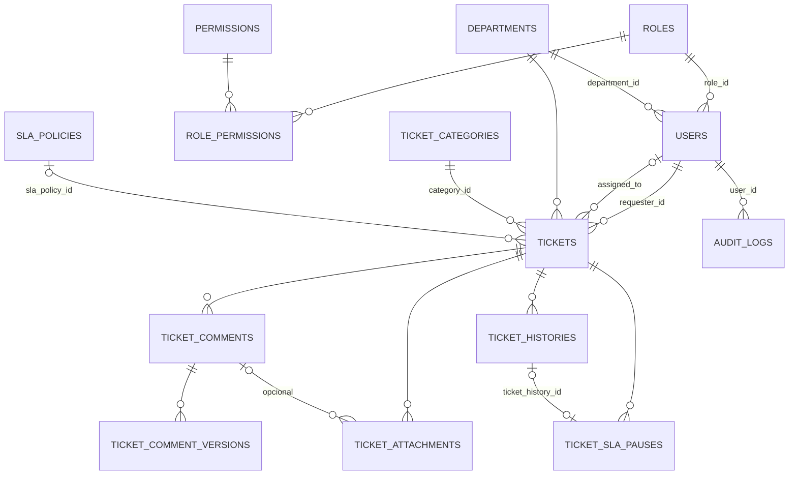

# Modelo de dados

18 migrations criam 21 tabelas (`database/migrations`). Fonte: as migrations e os models em `app/Models`.

## Diagrama

`audit_logs` se liga ao registro auditado por relação polimórfica (`auditable_type`, `auditable_id`): usuário, departamento, categoria, papel e política de SLA.

## Tabelas de domínio

| Tabela | Colunas principais | Observações |
|---|---|---|
| `users` | `name`, `email` (único), `password`, `role_id`, `department_id`, `is_active` | `role_id` e `department_id` são anuláveis (`restrictOnDelete`). Sem papel, o usuário não tem permissões. Não são atribuíveis em massa. |
| `roles` | `name`, `slug` (único), `description`, `is_system` | |
| `permissions` | `name`, `slug` (único), `description` | O módulo é o prefixo do `slug` (`tickets.`, `audit.`...). |
| `role_permissions` | `role_id`, `permission_id`, `created_at` | Único (`role_id`,`permission_id`). **Única tabela com `cascadeOnDelete`.** |
| `departments`, `ticket_categories` | `name`, `description`, `is_active` | Inativação no lugar de exclusão. |
| `tickets` | `ticket_number` (único, 11 caracteres), `title`, `description`, `category_id`, `requester_id`, `department_id`, `assigned_to`, `priority`, `status`, `first_response_at`, `resolved_at`, `closed_at`, `resolution_summary` | Índices em `priority`, `status`, `created_at`, `updated_at`. `priority` e `status` guardam o valor do enum. |
| colunas de SLA em `tickets` | `sla_policy_id`, `sla_first_response_minutes`, `sla_resolution_minutes`, `first_response_due_at`, `resolution_due_at`, `first_response_breached_at`, `resolution_breached_at`, `resolution_effective_seconds` | Metas copiadas da política na abertura ou na troca de prioridade. Todas anuláveis. |
| `ticket_comments` | `ticket_id`, `user_id`, `body`, `visibility` (`public`/`internal`) | Índice (`ticket_id`,`created_at`). Sem exclusão pelo fluxo normal. |
| `ticket_comment_versions` | `ticket_comment_id`, `edited_by`, `previous_body`, `previous_visibility`, `edited_at`, `created_at` | Somente-inserção. |
| `ticket_attachments` | `ticket_id`, `ticket_comment_id` (anulável), `uploaded_by`, `original_name`, `storage_path` (único), `mime_type`, `size_bytes`, `sha256` | Sem coluna de visibilidade: herdada da mensagem. `storage_path` e `sha256` ficam ocultos na serialização. |
| `ticket_histories` | `ticket_id`, `user_id` (anulável), `event_type`, `old_values` (JSON), `new_values` (JSON), `created_at` | Somente-inserção. `user_id` nulo para eventos do sistema (`sla_breached`). 17 tipos em `TicketEvent`. |
| `ticket_sla_pauses` | `ticket_id`, `ticket_history_id`, `pause_status`, `reason`, `supplier_name`, `protocol_number`, `related_department_id`, `responsible_name`, `expected_return_at`, `started_at`, `ended_at`, `duration_seconds`, `created_by` | Coluna gerada `active_ticket_id` com índice único: **no máximo uma pausa aberta por chamado**. |
| `sla_policies` | `priority`, `first_response_minutes`, `resolution_minutes`, `is_active` | Coluna virtual `active_priority` com índice único: **uma política ativa por prioridade**. |
| `audit_logs` | `user_id`, `event_type`, `auditable_type`, `auditable_id`, `old_values`, `new_values`, `created_at` | Somente-inserção. 19 tipos em `AdminEvent`. |

## Tabelas de infraestrutura Laravel

`password_reset_tokens`, `sessions`, `cache`, `cache_locks`, `jobs`, `job_batches`, `failed_jobs`.

## Convenções e integridade

- **Preservação do histórico (RN-19):** todas as chaves estrangeiras de domínio são `restrictOnDelete`. Nada é apagado pelo fluxo normal; a inativação (`is_active`) substitui a exclusão.
- **Efeito colateral conhecido:** `ProfileController::destroy` faz exclusão real do usuário. Para quem tem chamados, comentários ou eventos, a restrição das FKs deve impedi-la com erro de integridade. Ver [10-decisoes-e-debitos.md](10-decisoes-e-debitos.md).
- **Unicidade garantida no banco, não só na validação:** número do chamado, política ativa por prioridade, pausa ativa por chamado, caminho de anexo, par papel-permissão.
- **Colunas geradas** (`storedAs`, `virtualAs`) funcionam em MariaDB e SQLite, mas só foram exercitadas em SQLite pela suíte.
- **JSON:** `old_values` e `new_values` guardam também rótulos (por exemplo, nome do status) no momento do evento, para o histórico não depender do cadastro atual.
- **Metas copiadas:** editar uma política de SLA não reescreve chamados existentes.

## Dados iniciais (seeders)

| Seeder | O que cria |
|---|---|
| `RolesAndPermissionsSeeder` | 20 permissões e 4 papéis; associação inicial só para papéis recém-criados. Idempotente. |
| `LocalSuperAdminSeeder` | Papel `superadmin` com todas as permissões, apenas em ambiente `local`; atribui ao e-mail de `SEED_SUPERADMIN_EMAIL`. Idempotente. |
| `DatabaseSeeder` | Chama os dois anteriores e cria `test@example.com` via factory, sem papel. Não idempotente. |

Duas migrations de dados complementam o seeder em bancos já existentes: `grant_audit_view_to_technician_role` e `add_performance_report_permission`, ambas com `insertOrIgnore`.

## Não verificado

Os índices foram lidos nas migrations, mas planos de execução em MariaDB não foram analisados. O dump `helpdesk.sql` (que o `.gitignore` descreve como dados reais) não foi aberto.
