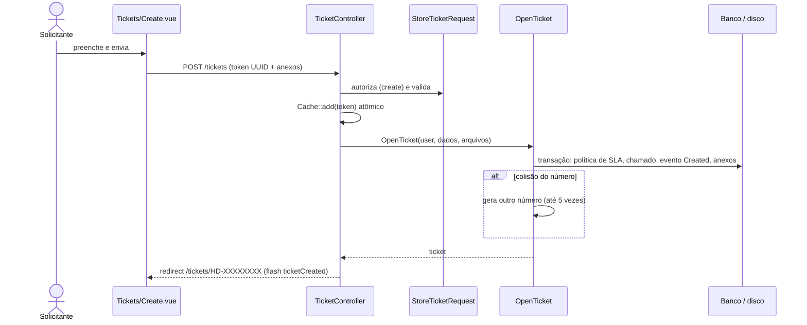
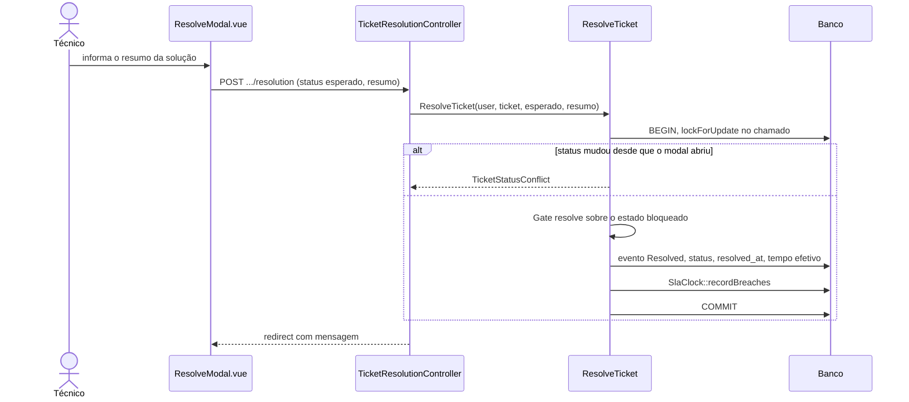
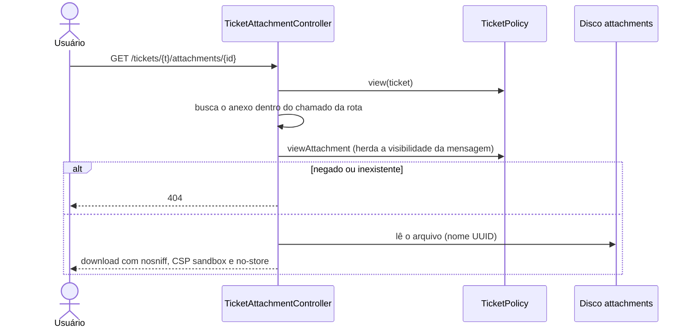
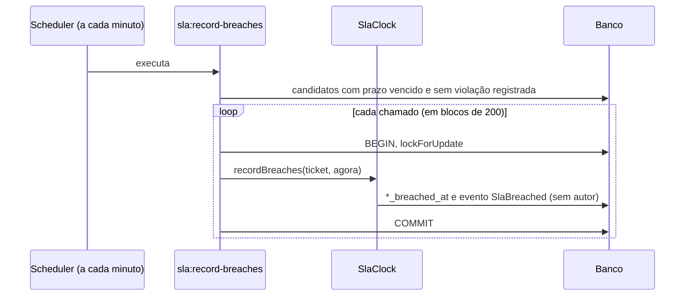

# Rotas e fluxos

Fonte: `routes/web.php` e `routes/auth.php` (leitura integral). Contagem conferida com `route:list`: 55 rotas em `web.php` e 15 em `auth.php`, mais `/design-system` (só em ambiente `local`). Todas as rotas de `web.php` abaixo usam `auth` e `verified`, salvo indicação.

As funcionalidades por trás das rotas estão agrupadas por módulo e ator em [casos-de-uso.md](../casos-de-uso.md), com os arquivos responsáveis.

## Mapa de rotas

### Públicas e autenticação

| Método e caminho | Controller | Observação |
|---|---|---|
| `GET /` | closure | Redireciona para `dashboard` ou `login`. |
| `GET/POST /register` | `RegisteredUserController` | Cria sempre um Solicitante e já autentica. Sem throttle próprio. |
| `GET/POST /login` | `AuthenticatedSessionController` | `LoginRequest` limita a 5 tentativas por e-mail+IP. |
| `GET/POST /forgot-password`, `GET /reset-password/{token}`, `POST /reset-password` | `PasswordResetLinkController`, `NewPasswordController` | Resposta sempre igual, exista a conta ou não. |
| `GET /verify-email`, `GET /verify-email/{id}/{hash}`, `POST /email/verification-notification` | Auth | Link assinado, throttle 6/min. |
| `GET/POST /confirm-password` | `ConfirmablePasswordController` | Nenhuma rota usa o middleware `password.confirm`. |
| `PUT /password`, `POST /logout` | Auth | |

### Chamados

| Método e caminho | Controller | Autorização |
|---|---|---|
| `GET /dashboard` | `DashboardController` | `viewAny` em `Ticket`; solicitante é redirecionado a `/tickets`. |
| `GET /tickets` | `TicketController@index` | `viewAny` e escopo `visibleTo`. |
| `GET /tickets/export` | `TicketExportController` | Papel `admin` ou `superadmin`. Declarada antes de `/tickets/{ticket}`. |
| `GET /tickets/create`, `POST /tickets` | `TicketController` | `create`. |
| `GET /tickets/{ticket}` | `TicketController@show` | `view`. |
| `GET /tickets/{ticket}/edit`, `PATCH /tickets/{ticket}` | `TicketEditController` | `update` e permissão por campo. |
| `PUT /tickets/{ticket}/assignee` | `TicketAssignmentController` | `assign` ou `reassign`. |
| `POST /tickets/{ticket}/self-assignment` | `TicketSelfAssignmentController` | Técnico elegível. |
| `PUT /tickets/{ticket}/status` | `TicketStatusController` | `tickets.change_status`. |
| `POST /tickets/{ticket}/pending` | `TicketPendingController` | `tickets.change_status`. |
| `POST /tickets/{ticket}/resolution` | `TicketResolutionController` | `tickets.resolve`. |
| `POST /tickets/{ticket}/reopening` | `TicketReopeningController` | Solicitante original. |
| `POST /tickets/{ticket}/closing` | `TicketClosingController` | `tickets.close`. |
| `POST /tickets/{ticket}/comments` | `TicketCommentController` | `comment` ou `addInternalNote`. |
| `GET /tickets/{ticket}/comments/{comment}/versions` | `TicketCommentVersionController` | `view` e filtro de visibilidade. JSON. |
| `GET /tickets/{ticket}/attachments/{attachment}` | `TicketAttachmentController` | `view` e `viewAttachment`; throttle 60/min. |
| `GET /tickets/{ticket}/sla-history` | `TicketSlaHistoryController` | `viewSla` (fora da visão restrita). JSON. |
| `GET /tickets/{ticket}/audit` | `TicketAuditController` | `audit.view` e acesso ao chamado. JSON paginado. |

### Administração e consulta

| Caminho | Controller | Permissão |
|---|---|---|
| `/admin/users` (index, create, store, edit, update) | `UserController` | `users.manage` |
| `/admin/departments` (5 rotas) | `DepartmentController` | `departments.manage` |
| `/admin/categories` (5 rotas) | `CategoryController` | `categories.manage` |
| `/admin/roles` (5 rotas) | `RoleController` | `roles.manage` |
| `GET /admin/roles/permissions`, `PUT /admin/roles/{role}/permissions` | `RolePermissionController` | `roles.manage` e `RolePolicy::managePermissions` |
| `GET /admin/permissions` | `PermissionController` | `roles.manage` (somente consulta) |
| `GET /performance` | `PerformanceController` | Gate `viewPerformance` |
| `GET /audit` | `AuditController` | `audit.view` e `tickets.view_all_departments` |
| `/sla-policies` (index, create, store, show, edit, update) | `SlaPolicyController` | `sla.manage` |

### Perfil (somente `auth`)

`GET/PATCH/DELETE /profile` em `ProfileController`.

### Cuidados de roteamento

- Rotas fixas (`export`, `create`) vêm antes das com parâmetro; as de identificador numérico usam `whereNumber`.
- Para evitar revelar identificadores, nas telas de edição a entidade só é carregada **depois** da autorização geral.
- A URL pública do chamado usa o `ticket_number`, não o `id`.

## Fluxos de ponta a ponta

### Abertura de chamado

### Resolução (padrão das demais ações)

### Download de anexo

### Violação de SLA por comando agendado

## Respostas JSON

Três endpoints devolvem JSON, abertos sob demanda por componentes Vue: versões de comentário, histórico de SLA e auditoria do chamado. Todos respondem com `Cache-Control: no-store, private`.
